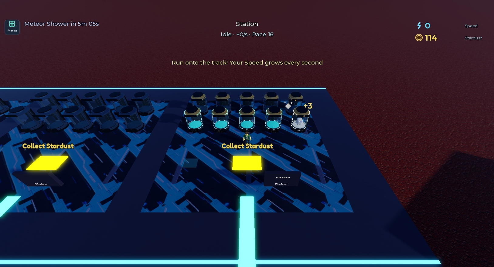
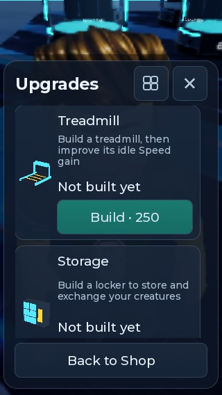
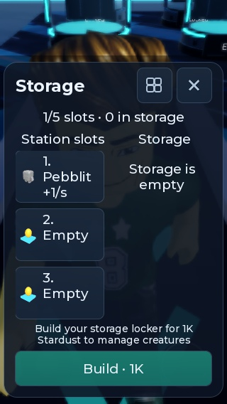
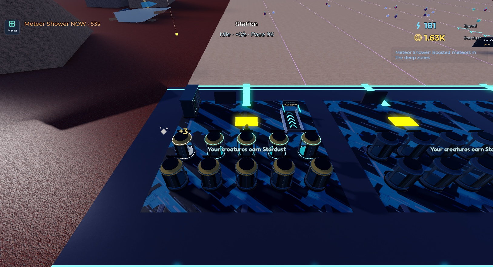

# Постройки базы и новое размещение — 14 октября 2026

Склад перенесён в дальний левый угол у прежней таблички станции: локальное смещение (-26, 0, -22), поворот -90°, экраном внутрь участка. Табличка теперь правее, в (-10, 6, -23). Центральный проход свободен. Корпус не пересекает капсулы, в том числе при всех десяти слотах.

## Развитие нового участка

- Дорожки и склада сначала нет. На полу остаются небольшие отметки покупки, доступные владельцу; чужие предложения скрыты.
- Подход к отметке открывает карточку с ценой. Оплата происходит только кнопкой Build. Дорожка стоит **250 Stardust**, склад — **1 000 Stardust**.
- Установка дорожки даёт прежние +0,5 Speed/с до множителей, затем доступны десять улучшений с прежними ценами и эффектами. Внутренний уровень 0 означает отсутствие дорожки, 1 — установку, 2–11 — улучшения.
- Склад покупается один раз. Можно купить его и заранее; заполнение базы подсказывает момент покупки, но не является жёстким запретом. Дополнительные платные места сейчас не вводятся.
- Если база полна, а склад не куплен, покупка существа за Stardust отклоняется без расхода валюты и запаса магазина. Уже оплаченные Robux-награды и другие выдачи сохраняются в storage; содержимое можно увидеть в меню и разместить после строительства. Удаления или замены предметов при строительстве нет.
- В меню Storage есть отдельная кнопка Build с ценой для ещё не построенного склада. Она оплачивает постройку с ожидаемым уровнем 0, поэтому повторный устаревший клик не покупает что-либо ещё.

## Сохранения и совместимость

Схема v4. Старые профили сохраняют оба ранее бесплатных объекта. При миграции v3→v4 внутренний уровень дорожки повышается на единицу, поэтому прежние эффекты и следующие цены сохраняются. Флаг warehouseOwned отмечается купленным. Новые профили v4 начинают без объектов. Предметы, мутации, paid, hatchAt, монеты и квитанции миграция не меняет. Rebirth не сбрасывает постройки.

Не купленные модели хранятся на сервере вне Workspace. После покупки в участок возвращается тот же объект; при смене владельца его состояние обновляется. Это сохраняет ссылки и соединения и не оставляет невидимых препятствий на пустом месте. Сервер отдельно запрещает тренировку на несуществующей дорожке и изменения через некупленный склад.

## Проверки

- **136 PASS с двумя клиентами**: новый пустой участок, отсутствие AFK-тренировки до установки, открытие карточки без списания, недостаток валюты, чужая отметка и большая дистанция, отказ от переполнения магазина, закрытый склад, установка по точной цене, устаревший клик, повторная покупка склада, реальные модели после оплаты, работа дорожки и подтверждённое сохранение. Прежние проверки меню, receipt, entitlement, хранения, обмена и кражи также прошли. [Полный результат](facility-purchases-2026-10-14/commerce.json).
- **14 чистых наборов Luau PASS**, включая Commerce **351**, Persistence **63**, StationInventory **24**. Добавлены проверки всех одиннадцати старых уровней, повторной миграции, разовой покупки и сохранности оплаченных наград до строительства.
- **Повторный вход в тот же изолированный QA-профиль**: дорожка с уровнем 1 и оплаченный склад восстановились как реальные объекты.
- **Окончательное размещение** после уточнения угла проверено отдельно в Studio: корпус целиком внутри участка; проверены AABB всех десяти капсул, пересечений нет; E у нового экрана открывает инвентарь. [Результат размещения и повторного входа](facility-purchases-2026-10-14/layout-and-rejoin.json).
- **Ручной ввод**: E у отметки дорожки открывает карточку; мышью в эмуляторе 320×548 оплачены дорожка и склад, обе модели появились. Проверены читаемость цены, закрытое хранилище и направленная к камере картинка склада.
- StyLua, Selene и luau-lsp без ошибок. Независимый read-only review: подтверждённых P1/P2 не осталось.

В QA обнаружено бесконечное ожидание PreRender в фоновом клиенте Studio; оно ограничено таймаутом. Успешный финальный прогон получил кадр (`rendered: true`) и подтвердил освобождение мыши после Sold out.

Тесты используют отдельные PreflightData_dev-профили. Настоящие касания телефона и Live Robux checkout этим прогоном не подтверждаются. CSV новых текстов экспортирован, облачная загрузка переводов не выполнена. Исходники синхронизированы в Studio; публикация в Roblox отдельно не подтверждена.

## Снимки

Новый профиль до оплаты:

Покупка дорожки на телефоне:

Склад до строительства:

Постройки после оплаты и повторного входа, окончательная расстановка:

