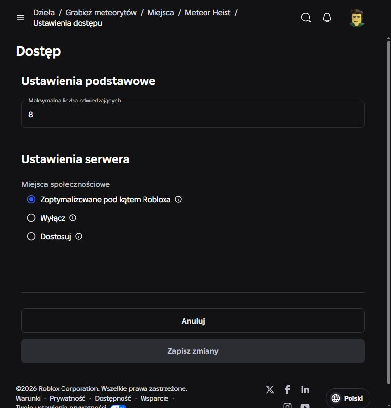

# Подготовка Meteor Heist к production — 12 октября 2026

> После этого этапа добавлен бесплатный прототип приветствия R6/R15. План и отдельные результаты проверки эмоции: [roadmap](../docs/09-zone-and-emote-roadmap.md). Это не меняет статус оставшихся проверок выпуска ниже.

Критические исправления внесены в исходники и синхронизированы в Roblox Studio. Публикация не выполнялась. Предыдущие изменения пользователя сохранены. Этот документ обновляет статус находок из `audit-2026-10-12.md`.

**Статус выпуска: критические исправления внесены, публичный запуск пока не подтверждён.** Покупки и передачи прошли многоклиентную проверку; лимит в Creator Hub установлен на восемь. Полноценный прогон на восьми клиентах и проверки опубликованной среды остаются открытыми.

## Что исправлено

| Область | Изменение |
|---|---|
| Подтверждение платежей | `PurchaseGranted` возвращается только после появления receipt в `LastSavedData` активной сессии. Выдача награды и отметка receipt применяются одной операцией; временная ошибка сохранения оставляет обработчик ожидающим. |
| Повторные платежи | Повтор одного receipt не дублирует награду. Уже оплаченная вторая покупка Starter Pack выдаёт полный набор и щит. Владение отражается в UI, сервер блокирует повторный prompt. |
| PolicyService | Политика и владение passes определяются до открытия профиля игровым сервисам. Ограниченные случайные покупки блокируются сервером; платные предметы проверяются при передаче. Для уже оплаченного ограниченного случайного товара предусмотрена фиксированная награда. |
| Server Luck | Абсолютное время действия сохраняется в профиле и восстанавливается при входе. Один receipt не продлевает бонус повторно. Для игроков с ограничениями создаются отдельные метеоры без платного повышения вероятности. |
| Сохранность предметов | Добавлены уникальные ID экземпляров, сохраняемые исходящие/входящие намерения и журнал передачи. Коммит происходит после сохранения намерения получателя; применённая награда отмечается в том же снимке данных. Неизвестный ответ DataStore сохраняет предмет в escrow для восстановления. |
| Отмена и выход | Незавершённая передача возвращает предмет владельцу; при полной станции он остаётся в storage. Уже завершённая передача не восстанавливается владельцу и не выдаётся повторно получателю. |
| Доход | Несобранные монеты находятся в профиле. Начисление дохода и времени игры учитывает реально прошедший интервал. Autosave ProfileStore настроен на 60 секунд. |
| Перемещение | Подбор, кража, сбор дохода, инвентарь, доставка и арена проверяют допустимость позиции перед изменением экономики. Недопустимая высота снимает груз до возврата домой; доставка из глубоких зон требует завершённого маршрута арены. |
| Загрузка и вместимость | Место резервируется до yielding-загрузки профиля, лимит — восемь. Отсутствие станции и ошибка preload закрывают вход. Загрузка ограничена 120 секундами, включая случаи, когда пользовательский `Cancel` отключает штатный таймаут ProfileStore. |
| Изоляция DEV/LIVE | `Config.Environment` разрешает исторические `PlayerData`/`Transfers` только universe `10770366757`, place `105876478663615`. Studio использует `_dev`; другие опубликованные places используют `_dev_<PlaceId>`, включая DEV внутри той же experience. |
| Покупной интерфейс | Цены запрашиваются на клиенте через `GetProductInfoAsync`; до получения цены покупка недоступна. Вероятности Server Luck раскрыты по контекстам зон, каньона и событий. Добавлен обещанный VIP chat tag. |
| Сборка | Модели и материалы экспортированы в версионируемые `.rbxmx` и подключены к Rojo. Репозиторий содержит 30 шаблонов существ и модели противников. |
| Проверки | Обновлён контракт тестов охранников; добавлены проверки сохранений, receipts, миграций, передачи и перемещения. CI проверяет формат, lint и типы также для `tests`. |

Основные файлы: `src/server/Services/DataService.luau`, `MonetizationService.luau`, `TransferService.luau`, `StationService.luau`, `SpeedService.luau`, `CarryService.luau`; протоколы и чистая логика — `src/server/Data/`; интерфейс — `src/client/Controllers/StoreController.luau`.

## Что проверено фактически

- `stylua --check src tests`: PASS.
- `selene src tests`: 0 ошибок, 0 предупреждений, 0 ошибок парсинга.
- `luau-lsp analyze` с актуальным Rojo sourcemap и закреплёнными определениями 1.70.1: PASS. Сообщение о `didChangeWatchedFiles` относится к режиму анализатора.
- `rojo build default.project.json`: PASS. XML-сборка содержит 68 Model, 53 MeshPart, 12 MaterialVariant, ManualWeld; битых `Ref` между объектами нет.
- Восемь наборов чистой логики: ArenaPatterns 905523, Income 9, Maze 27, MovementBudget 108, Persistence 63, Shop 5004, SnatcherCombat 168, StationInventory 14. Все PASS. Итого 910916 утверждений; основная часть — циклы геометрических проверок, а не независимые игровые сценарии.
- Обычный Playtest с реальным аккаунтом: сервер и клиент запускаются; PolicyService и pass-атрибуты получены. Проверено открытие окна вероятностей и переключение контекста.
- Финальный `StudioTestService:ExecuteMultiplayerTestAsync(2, ...)`: **PASS, 27 проверок**. Используется настоящий серверный контекст, отдельный `PreflightData_dev` и уникальные ключи запуска. Чеки синтетические, списания Robux нет. Записи ProfileStore и журнал передачи используют реальные Studio DataStore API.
- Пройдены первая покупка, повтор receipt, второй отдельный платёж Starter Pack, резервирование и доставка ровно одного ID, запрет повторной передачи, запрет передачи платного предмета по политике, отмена без дублирования, выход владельца с сохранённым возвратом, позднее подключение, Server Luck и отсутствие продления по повторному чеку, разрешение уже оплаченного ограниченного receipt фиксированной наградой, запрет обхода арены и возврата с грузом через высоту.
- Чистые тесты моделируют падения между фазами журнала и оба порядка восстановления профилей. Это не испытание принудительного падения настоящего опубликованного сервера.
- В Creator Hub подтверждён проект Meteor Heist и единственный place `105876478663615`. Максимальное число игроков изменено **с 50 на 8**, сохранено и проверено повторной загрузкой страницы. Это изменение конфигурации, а не публикация исходников.



## Ограничения многоклиентного прогона

Полный сценарий дошёл до успешной проверки позднего подключения, затем достиг первоначального общего таймаута при добавлении шести клиентов. Отдельный запуск на восемь клиентов также не завершился успешно: в одной попытке сервер видел семь игроков с готовыми профилями и станциями; в другой — только три подключения с незавершённой загрузкой. Журнал допусков последнего запуска не показал отклонения по лимиту игры. Точная причина остаётся неустановленной; результат на восемь игроков **не заявляется как PASS**.

В Output отдельно воспроизводится `cloud_1543506195.Model.LocalScript:1: ... nil.Character`. Этого скрипта нет в исходниках игры. Его источник не удалялся; связи с отказом восьмого клиента не доказано.

## Что необходимо завершить перед публичным трафиком

1. Получить успешный тест на восьми реальных клиентах: одновременно назначенные станции, выход/замена игрока, стабильность CPU/памяти и отсутствие лишнего допуска. Повторить на приватном опубликованном сервере, если Studio снова не подключает клиентов.
2. Проверить в приватной опубликованной среде реальные Marketplace receipts, региональные цены, повторный вход с сохранёнными данными и штатное закрытие сервера. Синтетические чеки не подтверждают платёжную цепочку Roblox.
3. При создании нового LIVE place обновить оба ID в `Config.Environment`; иначе он будет безопасно использовать DEV-хранилище. Проверить фактическое имя хранилища после публикации.
4. Проверить разрешения всех MeshId/TextureId от имени experience и мобильный игровой цикл: подбор → обратный маршрут → арена → доставка → магазин. XML-сборка подтверждает наличие объектов, а не разрешения на загрузку ассетов в production.
5. Загрузить новые строки `localization/upload/part*.csv` в Creator Hub. Наличие CSV не означает, что переводы уже опубликованы.

## Изменения поведения, которые нужно учитывать

- У старых предметов невозможно восстановить платное происхождение. Миграция консервативно отмечает их `paid = true`; для аккаунтов с запретом paid trading это ограничивает передачу таких предметов.
- Фиксированная компенсация уже оплаченного ограниченного случайного товара — `Products.RESTRICTED_REWARD`, сейчас `cosmic_leviathan`. Для Crate3 выдаётся три таких предмета, для Server Luck — один. Это защищает от оплаченного receipt без награды, но влияет на экономику и должно быть известно владельцу игры.
- При недоступности политики, passes, миграции или восстановления передачи игрок не допускается к экономике; повторный вход безопаснее работы с неполным профилем.
- При аварии обычный прогресс ограничен последним успешным autosave. Подтверждённые покупки и коммиты передачи имеют дополнительное подтверждение сохранения; абсолютная сохранность каждого кадра игрового процесса не заявляется.

## Воспроизведение

```powershell
python -I scripts/mcp_sync.py
python -I scripts/run_studio_checks.py
stylua --check src tests
selene src tests
rojo sourcemap default.project.json -o sourcemap.json
luau-lsp analyze --sourcemap=sourcemap.json --definitions=.luau/globalTypes-1.70.1.d.luau src tests
rojo build default.project.json -o build.rbxl
```

Многоклиентная проверка запускается из PluginSecurity/Edit через MCP; выполняется серверным `src/server/Tests/Preflight.server.luau`, который выключен вне Studio и без аргумента `suite = "preprod"`:

```lua
game:GetService("StudioTestService"):ExecuteMultiplayerTestAsync(2, {
    suite = "preprod",
    mode = "transactions",
    runId = game:GetService("HttpService"):GenerateGUID(false),
})
-- Для вместимости: 8 клиентов и mode = "capacity".
```

Основания протоколов: [ProfileStore developer products](https://madstudioroblox.github.io/ProfileStore/devproducts/), [Roblox paid random items](https://create.roblox.com/docs/production/monetization/paid-random-items), [StudioTestService](https://create.roblox.com/docs/reference/engine/classes/StudioTestService).
