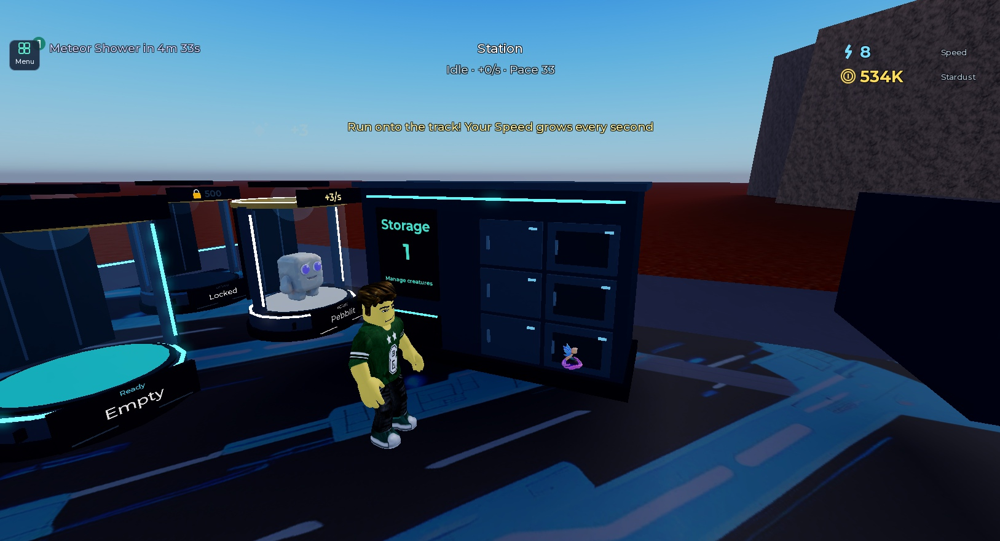
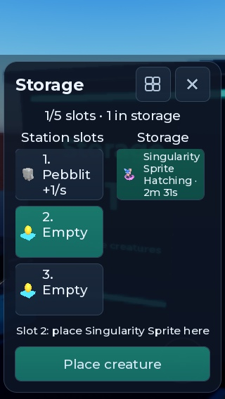
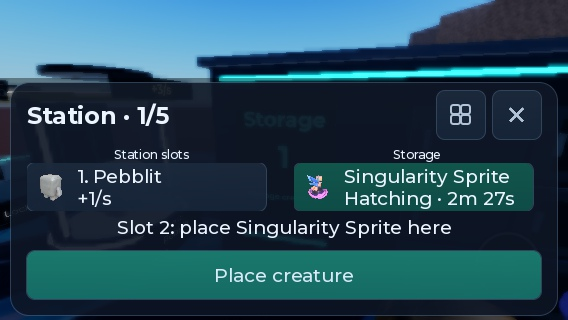

# Проверка личного склада — 14 октября 2026

Добавлен физический склад-локер на каждом участке. Используется существующий инвентарь станции: перенос с пьедестала, ручное размещение и обмен с сохранением прежнего предмета. Сервер проверяет владельца, дистанцию, состояние персонажа и ключи предметов. Старое автоматическое извлечение содержимого склада на свободные пьедесталы отключено.

## Результаты

- Финальный двухклиентный прогон: **105 PASS**, включая прежние сценарии покупок, идемпотентных receipt, entitlement и кражи соседней базы. [Полный результат](warehouse-2026-10-14/commerce-final.json).
- Склад: собственный терминал открывается; чужой доступ и действия издалека отклоняются; клиентские витрины не реплицируются серверу или соседу; перенос сохраняет идентичность, Golden, paid и hatchAt; повтор запроса не дублирует предмет; сохранение профиля подтверждено; свободное место не опустошает склад автоматически; склад не приносит пассивный доход; размещение и обмен работают с точным выбранным слотом; устаревший обмен отклоняется.
- 14 чистых наборов Luau PASS, включая **StationInventory 24**: перенос/возврат, сохранение метаданных, повтор, устаревший ключ, закрытый слот и некорректные числа.
- StyLua, Selene и строгая проверка luau-lsp: без ошибок. Независимый read-only review не выявил подтверждённых P1/P2.
- Повторный прогон выявил гонку в самом QA-сценарии: карточка станции ожидалась ровно 0,3 секунды после сетевого запроса. Ожидание заменено ограниченным ожиданием появления карточки; проверки игрового результата сохранены.
- Ручной прогон реальными MCP-вводами: E открывает окно; выбор карточки и Store убирают предмет; Place возвращает его на выбранный пьедестал. Мобильная эмуляция 320×548 и 568×300; проверены длинное имя, мутация, таймер вылупления и адаптация высоты карточек. Это не заменяет проверку касаний на настоящем устройстве.

## Снимки

## Границы проверки

Тесты выполнялись с изолированными QA-профилями PreflightData_dev, реальные профили игроков не использовались. Live Robux checkout, реальный телефон и новая серверная сессия опубликованной игры этим прогоном не подтверждаются.

Новые локализуемые строки экспортированы в CSV, облачная загрузка не выполнена из-за таймаута браузерного подключения к Creator Hub. Весь накопленный список переводов сохранён. Сборка синхронизирована в Studio; публикация этой версии не подтверждена.

Существующий неограниченный список storage при очень большом накоплении может потребовать виртуализации карточек с ViewportFrame. В текущем прогоне проблемы производительности списка не воспроизведены.
