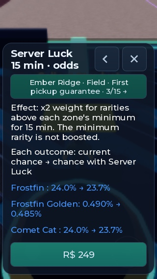
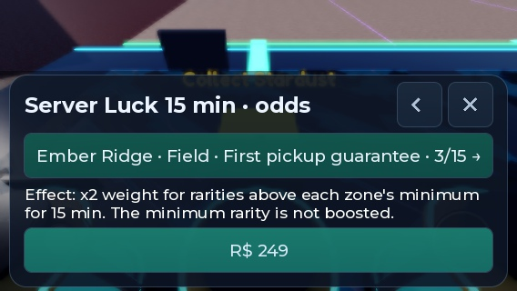

# Прогрессия зон, существ и дохода — 14 октября 2026

Дальние зоны теперь имеют собственный минимальный уровень добычи. Обычные метеориты четвёртой зоны больше не дают Common/Uncommon/Rare, пятой — ничего ниже Legendary. Редкость определяет базовый доход; внутри редкости остаются несколько видов существ. Исходники синхронизированы в Studio. Публикация этой версии в Roblox не подтверждена.

## Изменения

| Зона | Распределение обычного поля | Минимальный доход | Средний доход до бонусов |
|---|---|---:|---:|
| 1 | Common 80 / Uncommon 18 / Rare 2% | 1/с | 1,82/с |
| 2 | Uncommon 70 / Rare 28 / Epic 2% | 4/с | 8,20/с |
| 3 | Rare 70 / Epic 28 / Legendary 2% | 15/с | 32,30/с |
| 4 | Epic 75 / Legendary 24 / Mythic 1% | 60/с | 117/с |
| 5 | Legendary 90 / Mythic 10% | 250/с | 345/с |

Цифры относятся к взрослому существу в капсуле, без Golden, Luck, Rebirth и платных множителей. Гарантия первого подбора во второй зоне учитывается отдельно. Доход появляется после доставки и вылупления; склад не производит валюту.

- Виды открываются по первой доступной полевой зоне, без появления будущих видов раньше срока. Все 30 видов доступны, каждое ненулевое сочетание «зона + редкость» содержит минимум два вида. Магазин сохраняет общий ассортимент своей редкости.
- Время вылупления: **10 с / 30 с / 90 с / 3 мин / 5 мин / 10 мин**. Прежние длинные таймеры ограничиваются при входе; готовые и короткие не продлеваются. Формат сохранений остаётся v4, ID/вид/редкость/мутация/paid сохраняются.
- Luck, каньон и дождь усиливают редкости выше минимума зоны. Ранее умножение всех ненулевых весов в дальней зоне на одно число полностью отменило бы эффект после нормализации. Окно покупки использует ту же формулу, включая вид и Golden.
- Для первого подбора во второй зоне есть отдельный контекст: Rare/Epic 98/2%; с ×2 — 126/130 и 4/130. Старые облачные тексты не подменяют новые правила: семантически изменённые строки получили новые ключи локализации.
- Цены и требования ворот, улучшений, Rebirth остаются прежними.

## Проверки

**15 чистых наборов Luau PASS.** Новый ZoneProgression: **125 504 проверки**, включая 125 000 бросков по пяти зонам и усилениям 1/2/3/6/18, соответствие частот показанным шансам, исключение будущих видов, доступность всех видов, гарантии и сокращение таймеров без потери предметов. Прежние Commerce 351, Persistence 63, Shop 5004 и StationInventory 24 также прошли.

**Два клиента: 190 PASS.** [Сырой результат](zone-progression-2026-10-14/commerce.json), runId `zone-progression-final-1791966148`. Проверены естественные серверные метеориты во всех пяти зонах, фактический серверный обработчик подбора, минимальный доход, происхождение груза и дождь. Существующие сценарии покупок, сохранения, склада, меню и краж также прошли. Прогон работает в изолированных `PreflightData_dev`, реальный инвентарь не меняет.

Синтетическое удержание ProximityPrompt в фоновых тестовых клиентах Studio не вызывало событие надёжно. Поэтому автоматический прогон вызывает тот же приватный серверный обработчик через QA-only метод, закрытый вне Studio commerce suite. Отдельно выполнен подбор **клавишей E** у естественного метеорита в зоне 4: сервер подтвердил `Carrying=Epic`, `CarryIncome=60`. Это проверяет связь реального ввода с обработчиком; прохождение всего лабиринта и арены этим действием не подтверждается.

**Мобильное окно платной удачи:** эмулятор HUD_QA_320, исходное разрешение 568×320, портретный viewport 320×548 и альбомный 568×300; `ScreenOrientation=Sensor`. Контекст гарантии, формулировка эффекта и строки исходов показаны корректно, TextFits=true, содержимое прокручивается. Закрытие мышью выполнено; `MouseBehavior=Default`. Стандартный размер viewport Studio восстановлен. Физические касания телефона и настоящий Robux checkout не проверялись.





Повторная загрузка оплаченного Golden Mythic проверена отдельно с сохранённым восьмичасовым таймером. После первого входа осталось 596 с, после второго — 527 с; дата вылупления не изменилась. ID, вид, редкость, Golden и paid сохранились. Другой уже истёкший старый таймер при загрузке не перезапустился. [Сравнение входов и UI](zone-progression-2026-10-14/rejoin-and-ui.json).

StyLua, Selene и строгий luau-lsp прошли. Независимый read-only review подтвердил исправление FTUE odds, новых существенных замечаний не осталось.

## Сравнение баланса

`tools/balance_sim.py` теперь читает экспорт настоящего Config, вместо устаревающих копий чисел в Python. [До изменения](zone-progression-2026-10-14/before.json), [после](zone-progression-2026-10-14/config.json), [результаты](zone-progression-2026-10-14/balance.json).

600 модельных сессий по три часа: до/после × 100 seed × доля неудачных доставок 0/20/40%. Политика: самая дальняя открытая зона, случайный метеорит, 70% каньонных бросков с ×2, коридор арены по Config, 6 с на взаимодействия, покупка дорожки/склада/слотов/тренировки, лучшие взрослые существа на капсулах. Стартовый Common соответствует обучению. Без Robux, магазина, AFK, событий и друзей. Неудача консервативно тратит полный маршрут. Обходы лабиринта, умение пользоваться меню и фактический бой не моделируются.

| Неудачные доставки | Первый Rebirth, до → после | Зона 5, после |
|---|---|---|
| 0% | 100,71 → 67,44 мин | 132,14 мин |
| 20% | 106,45 → 68,08 мин | 133,29 мин |
| 40% | 111,85 → 68,72 мин | 133,96 мин |

Медианы после изменения: все 100 запусков каждого сценария достигли обеих целей за три часа. До изменения пятую зону достигали 71/52/34 запуска соответственно. Модель объясняет, почему цены пока не повышались: теперь улучшения доступны раньше, но скорость и Rebirth продолжают ограничивать дальние ворота. Это оценка активной стратегии, а не прогноз поведения живого игрока или удержания.

Воспроизведение после остановки Play и синхронизации:

```powershell
python -X utf8 -I scripts/run_studio_checks.py
python -X utf8 -I scripts/export_balance_config.py reports/zone-progression-2026-10-14/config.json
python -u -X utf8 -I tools/balance_sim.py --config reports/zone-progression-2026-10-14/config.json --before reports/zone-progression-2026-10-14/before.json --out reports/zone-progression-2026-10-14/balance.json --seeds 100 --hours 3
```

## Осталось перед live-приёмкой

Резервная сборка из исходников: `C:\Users\user\AppData\Local\Temp\meteor-heist-zone-progression-ready-2026-10-14.rbxlx`. Релизный Git-тег: `zone-progression-ready-2026-10-14`. Отладочные атрибуты тестов удалены из Edit перед завершением.

- Опубликовать проверенную сборку из Studio и проверить новый сервер Roblox.
- Загрузить обновлённый CSV локализации: экспортированы 343 записи и пакет из 163 ожидающих строк, включая ранее не загруженные. Сейчас новые ключи корректно используют английский fallback.
- Пройти живые маршруты на телефоне, замерить доставки, арену и прогресс первых 30–60 минут. Скорость получения высоких редкостей нужно оценить по реальным игрокам перед следующим изменением цен.
